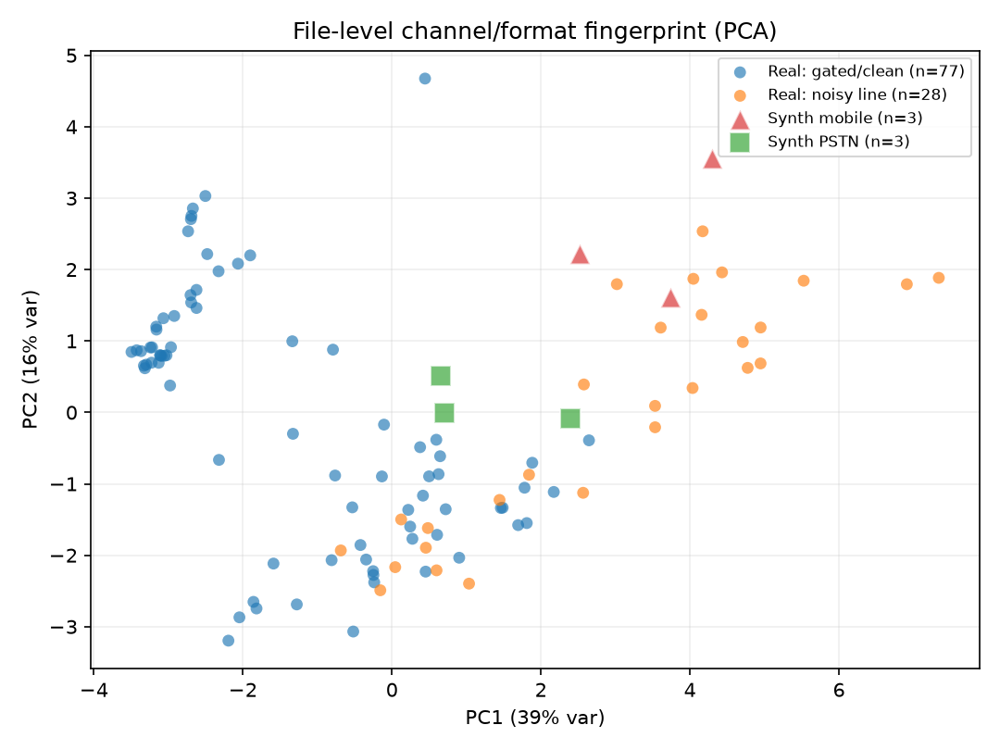
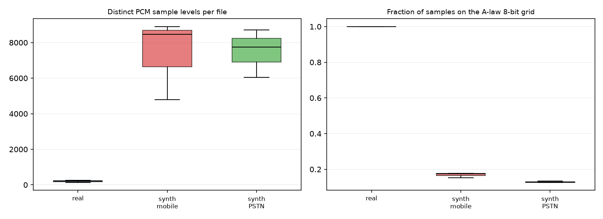
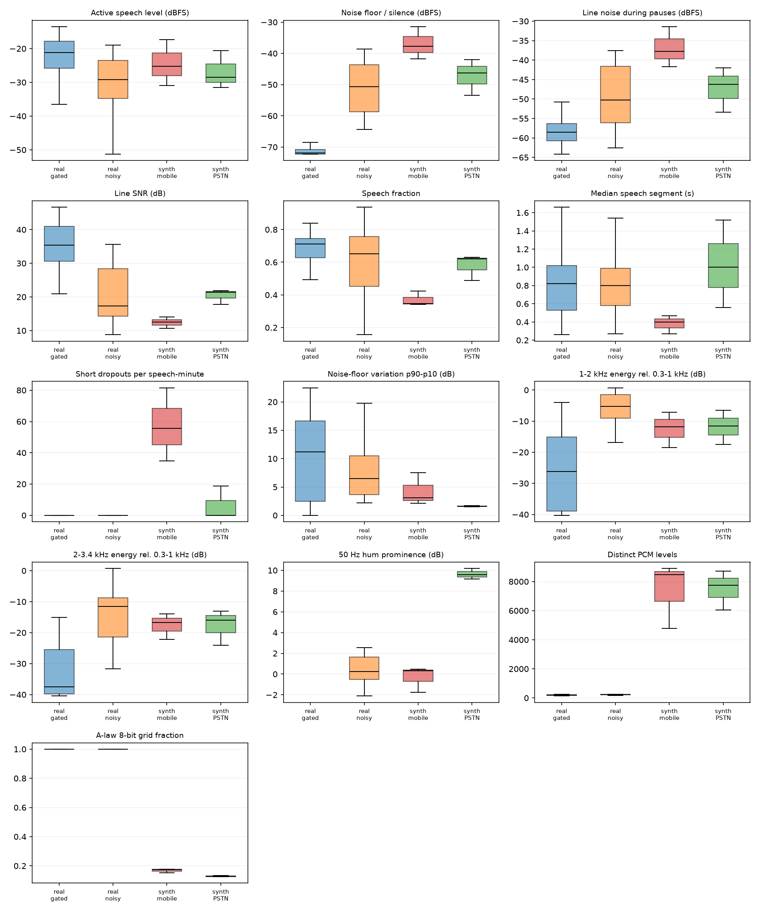
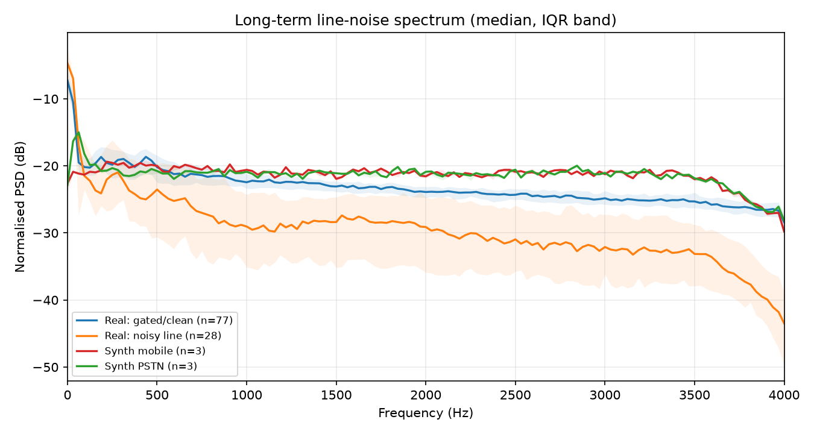
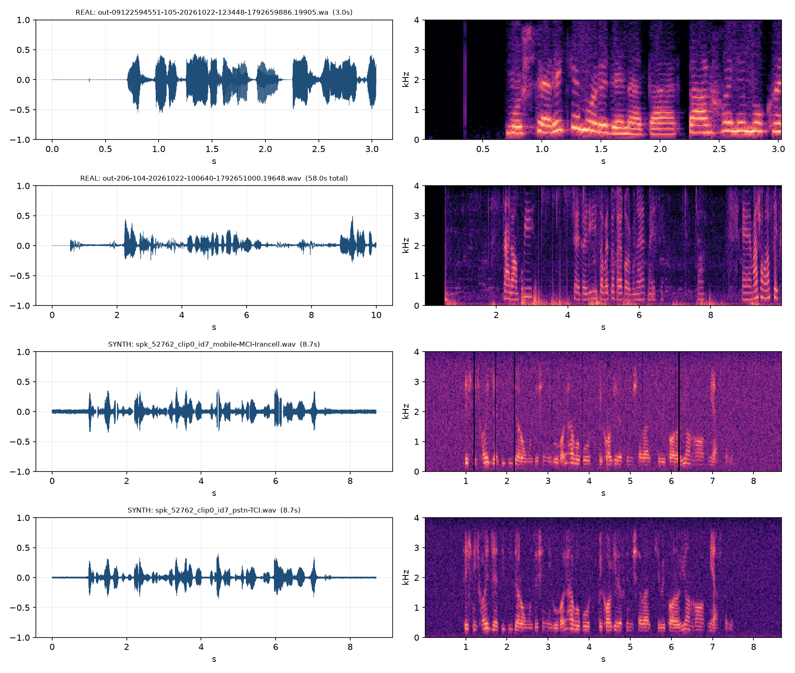
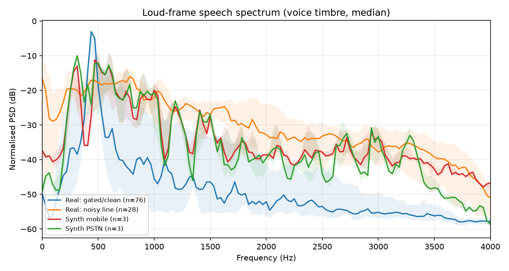
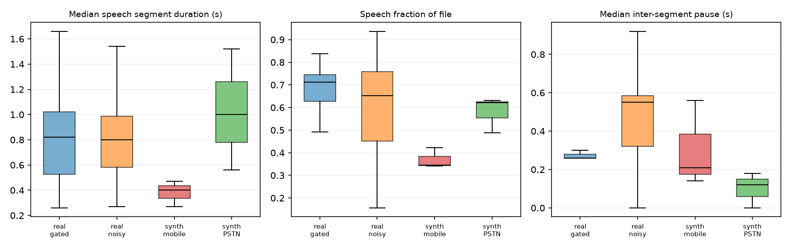
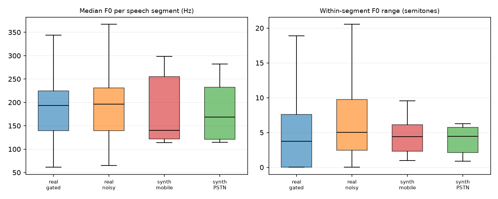

# Synth vs real phone-call audio — match report

**Date:** 2026-10-29<br>
**Corpus:** `RecordingTesting/telephone_clips/`<br>
**Synth implementation under test:** `src/telephone.py` (`simulate_mobile` / `simulate_pstn`)

---

## TL;DR

The synth captures the **gross telephone character** — band-limited speech, plausible active-speech level, peak level, and segment-level pitch range — but it does **not yet match the real recordings** on the details that dominate a real call recording:

1. **Recording format.** All 105 valid real files contain **bit-exact G.711 A-law-decoded samples** (8 kHz PCM16 WAV). The synth files are 16 kHz PCM16 files whose samples come from the post-codec float pipeline, with 6.6k–8.7k distinct PCM levels. They are not on the A-law grid at all.
2. **Noise.** The synth adds **white Gaussian noise** at an SNR that is too low, especially for mobile. Real calls are either **digital-silence gated** (77/105, 73 %) or have **coloured low-frequency line noise** (28/105, 27 %). The synth has neither population.
3. **Mobile dropouts.** The mobile profile creates **~56 short zeroed dropouts per speech-minute**; real calls have **0**. Real AMR networks conceal packet loss; they do not write exact zero spans.
4. **PSTN hum.** The PSTN profile has a **9.6 dB** 50 Hz hum prominence; real noisy calls have **0.2 dB**, and gated calls have none.
5. **Spectral envelope.** The synth sits *between* the two real populations. It is far too bright for the dominant gated/clean calls and 5–7 dB too dark in the 1–3.4 kHz region for noisy calls. No single synth profile reproduces either population.
6. **Conversation structure.** Real files are 14–46 s calls with 11–19 speech segments; synth clips are 5 s single utterances. Mobile is especially sparse (35 % speech vs 65–71 % real).

**Bottom line:** the PSTN profile is materially closer to the real *noisy-line* subset. The mobile profile is the weaker one. Neither profile matches the dominant *gated/clean* population, which is 73 % of this corpus.

---

## Corpus and method

### Real recordings

| Item | Value |
|---|---|
| Files | 107 |
| Usable | 105 (two 0-frame WAVs: `out-208-104-…19891.wav`, `out-211-104-…19644.wav`) |
| Format | 8 kHz, mono, 16-bit PCM WAV containing **G.711 A-law** samples |
| Duration | median 15.9 s (IQR 7.6–45.7 s), max 337.7 s |
| Content | call-centre conversations, hold/IVR, a few short test tones |
| A-law check | `audioop.lin2alaw` → `alaw2lin` reproduces **every sample** of all 105 non-empty files |
| Channel populations | **77 gated/clean** (noise floor < −65 dBFS); **28 noisy line** (continuous line noise) |

The "gated/clean" files have digital silence between utterances: the silence samples are the A-law zero code (`±8`). The "noisy line" files have continuous low-frequency line noise. The split is empirical (noise floor < −65 dBFS); it is not a ground-truth carrier label.

### Synth recordings

| Item | Value |
|---|---|
| Files | 6 |
| Speakers | 3 (`spk_25692`, `spk_52762`, `spk_81306`) |
| Profiles | 3 mobile (`mobile-MCI-Irancell`) + 3 PSTN (`pstn-TCI`) |
| Format | 16 kHz, mono, 16-bit PCM WAV |
| Duration | 3.1–8.7 s (median 5.0 s) |

The synth clips are single TTS utterances passed through the telephone simulator, not full conversations. The analysis therefore separates channel/artifact metrics from conversational-structure metrics where possible.

### Features

- All files resampled to 8 kHz for a common comparison; fake files were downsampled with a polyphase anti-alias filter.
- 20 ms energy VAD per file, with relative thresholds based on each file's noise floor and speech level.
- 32 ms Hann PSD; speech spectrum, loud-frame spectrum (top 10 % energy), and line-noise spectrum computed separately.
- Praat autocorrelation pitch and HNR on speech segments.
- A-law grid / PCM-codebook signature from the int16 samples.
- Segment-level statistics from VAD speech runs (1,797 real segments, 18 synth segments).
- Full per-file and per-segment features: `features_files.csv`, `features_segments.csv`.

### Limitations

- Only **6 synth clips** (3 speakers × 2 profiles), so profile-level conclusions are directional, not statistically tight.
- The exact synth generation command/seed was not available; the six clips are treated as representative of the current `simulate_mobile` / `simulate_pstn` defaults.
- Real calls come from **one day and one call centre**; carrier labels (MCI/Irancell/TCI) are unknown.
- Some real files contain hold music/IVR; VAD may count tonal/musical segments as speech, so duration/pause/segment statistics are approximate.
- VAD is approximate, especially on noisy calls; silence/pause metrics should be read as relative.
- No content/ASR comparison was attempted; this report is about the **acoustic channel**, not transcription accuracy.

---

## Scorecard

Ratings compare the synth profile to the **whole real corpus**, with the noisy-line subset called out where relevant.

| Aspect | Synth mobile | Synth PSTN | Evidence |
|---|---|---|---|
| Recording format | ❌ | ❌ | 16 kHz, 6.6k–8.7k PCM levels vs 8 kHz, 191–246 levels, 100 % A-law grid |
| Active speech level / peak | ✅ | ✅ | −25.2 / −7.9 dBFS (mobile), −28.5 / −8.0 (PSTN) vs real −21…−29 / −7 |
| Speech spectrum | ⚠️ | ⚠️ | Between gated and noisy populations; matches neither |
| Noise level | ❌ | ⚠️ | Mobile 12.5 dB SNR vs 17.3 noisy / 35.4 gated; PSTN 21.4 |
| Noise texture | ❌ | ❌ | White/flat, high-frequency-heavy vs coloured/low-frequency real noise |
| 50 Hz hum | ✅ | ❌ | 0.3 dB mobile vs 0.2 dB real; PSTN 9.6 dB |
| Mobile dropouts | ❌ | ✅ | 55.6 short dips/speech-min mobile vs 0 real; PSTN ~0 |
| Prosody / F0 | ✅ | ✅ | Segment F0 range 4.4 st vs 3.8–5.0 st |
| HNR | ⚠️ | ✅ | 10.2 dB mobile vs 10.5–15.1 real; 11.8 dB PSTN |
| Temporal structure | ❌ | ⚠️ | Mobile 35 % speech / 0.4 s segments; PSTN 62 % / 1.0 s; real 65–71 % / 0.8–1.0 s |
| Conversational realism | ❌ | ❌ | Single utterances, no turn-taking, no double-talk |



*PCA of file-level channel/format features. Real gated/clean calls form a distinct cluster (left); noisy-line calls spread across the centre/right. Synth PSTN lands inside the noisy-line cloud; synth mobile sits at its edge, outside the gated population. The separation is driven by noise/spectrum/format, not by pitch.*

---

## Findings

### 1. The real corpus is G.711 A-law; the synth output is not

Every valid real file is exactly on the A-law 8-bit grid:

- 191–246 distinct sample levels per file
- 100 % of samples are multiples of 8
- minimum non-zero magnitude = 8
- `audioop.lin2alaw` → `alaw2lin` is **bit-exact** for all 105 files

Synth files after downsampling to 8 kHz:

- 6,640–8,691 distinct levels
- only 13–18 % of samples land on the A-law grid
- 16 kHz native sample rate

The simulator does apply A-law in the PSTN path, but it then adds noise, hum, gain, and resampling **after** the codec, so the final file is no longer a G.711 recording. Real calls are the recorder's A-law stream, end to end.

**What-if:** applying a final 8 kHz A-law round-trip to the synth files produces 172–230 distinct levels, 100 % on the A-law grid, at ~37 dB quantization SNR — exactly the real format. This is the cheapest high-impact fix.



### 2. Noise level and SNR are too aggressive, especially for mobile

| Metric | Real gated/clean (n=77) | Real noisy line (n=28) | Synth mobile (n=3) | Synth PSTN (n=3) |
|---|---:|---:|---:|---:|
| Line noise during pauses (dBFS) | −58.6 [−60.8, −56.4] | −50.2 [−56.1, −41.6] | **−37.8** [−39.7, −34.6] | −46.3 [−49.8, −44.1] |
| Line SNR (dB) | 35.4 [30.6, 40.9] | 17.3 [14.3, 28.3] | **12.5** [11.6, 13.3] | 21.4 [19.6, 21.6] |
| Noise-floor variation p90−p10 (dB) | 11.2 [2.5, 16.7] | 6.5 [3.7, 10.5] | **3.1** [2.6, 5.3] | **1.6** [1.6, 1.7] |

- Mobile's line-noise floor is **~12 dB above** the noisy-line median and **~21 dB above** the gated median; its SNR is 12.5 dB vs 17.3 dB (noisy) / 35.4 dB (gated).
- PSTN's line-noise floor is within **4 dB** of the noisy-line median (and 12 dB above the gated median); its SNR is 21.4 dB vs 17.3 dB (noisy) / 35.4 dB (gated).
- The synth noise is **too stationary**: 1.6–3.1 dB variation vs 6.5–11.2 dB real.
- 73 % of the real corpus has **no continuous noise at all** between utterances. The simulator has no clean/gated mode, so it cannot produce that population.
- The gated line-noise figure is from the 67/77 files that have a measurable non-silent noise floor; the other 10 are pure A-law digital silence.



### 3. Noise texture is white; real noise is coloured and low-frequency-heavy

| Metric | Real gated/clean | Real noisy line | Synth mobile | Synth PSTN |
|---|---:|---:|---:|---:|
| Noise spectral flatness (0–1) | 0.37 [0.31, 0.45] | **0.14** [0.05, 0.22] | **0.52** [0.52, 0.53] | **0.53** [0.53, 0.53] |
| Noise <500 Hz / >500 Hz | 0.90 | **5.84** [1.60, 23.81] | **0.18** | **0.22** |
| Noise slope (dB/decade) | −5.0 | **−8.6** [−10.5, −6.9] | **−1.0** | **−0.4** |

The synth's white Gaussian noise fills the entire 0–4 kHz band. Real line noise is strongly low-frequency dominated (5.8× more energy below 500 Hz than above; −8.6 dB/decade slope). This is visible both in the numbers and in the noise spectrogram.



### 4. PSTN hum is roughly 10 dB too prominent

- Real noisy calls: 50 Hz prominence **0.2 dB** [−0.5, 1.6]
- Real gated calls: no measurable hum
- Synth PSTN: **9.6 dB** [9.4, 9.9]
- Synth mobile: 0.3 dB (fine)

The simulator adds hum at −40 to −30 dB relative to speech RMS, **after** the 300–3400 Hz band-pass, so it survives at full strength. Real 50 Hz hum is mostly absent in this corpus. If hum is kept as a rare condition, it should be at least 10–20 dB lower.

### 5. Mobile dropouts are far too frequent and too deep

- Synth mobile: **55.6 short zero dips per speech-minute** [45.2, 68.5]
- Real: **0** in all 105 valid files
- Synth PSTN: 0 median (one clip has 9.4/min)

The mobile simulator zeroes 2 % of 20 ms frames for 20–60 ms. That is visible as regular black stripes in the spectrogram. Real AMR networks conceal lost frames; the decoded stream continues with extrapolated speech, and the A-law recorder never stores exact zero spans inside speech. This is likely the single most audible mobile artifact.



*Top two: a gated/clean real call and a noisy-line real call. Bottom two: the same TTS speaker through the mobile and PSTN simulators. Note the white noise haze and the mobile dropout stripes.*

### 6. Spectral envelope: synth is between the two real populations

| Metric | Real gated/clean | Real noisy line | Synth mobile | Synth PSTN |
|---|---:|---:|---:|---:|
| Speech centroid (Hz) | 450 | 518 | **634** | **627** |
| 95 % rolloff (Hz) | 562 | 1,375 | **1,469** | **1,188** |
| 1–2 kHz rel. 0.3–1 kHz (dB) | −26.1 | −5.2 | **−11.8** | **−11.5** |
| 2–3.4 kHz rel. 0.3–1 kHz (dB) | −37.6 | −11.5 | **−16.7** | **−16.0** |
| 3.4–4 kHz rel. 0.3–1 kHz (dB) | −44.1 | −23.5 | **−30.1** | **−37.9** |

Interpretation:

- **Against the gated/clean majority**, the synth is far too bright: roughly 15–21 dB too much energy above 1 kHz, and a 95 % rolloff 2–2.6× higher.
- **Against the noisy-line subset**, the synth is 5–7 dB *darker* in 1–3.4 kHz, while its low-frequency hum/noise pushes the centroid up. It is not simply "too bright" or "too dark"; the **shape** is wrong.
- The 300 Hz high-pass also removes real low-frequency speech energy. Real gated calls retain ~7.5 % of speech energy in 100–300 Hz; the synth's PSTN profile has 61 % there, mostly from hum. The low-frequency balance is therefore wrong even when the overall tilt looks similar.
- No single fixed channel filter can match both populations. The corpus needs at least two channel conditions (gated/clean vs noisy line), and the synth needs a filter calibrated for each.



### 7. Temporal structure: mobile is too sparse; PSTN is closer

| Metric | Real gated/clean | Real noisy line | Synth mobile | Synth PSTN |
|---|---:|---:|---:|---:|
| Speech fraction | 0.71 | 0.65 | **0.35** | 0.62 |
| Median speech segment (s) | 0.82 | 0.80 | **0.40** | 1.00 |
| Median pause (s) | 0.26 | 0.55 | 0.21 | **0.12** |
| Speech segments per file | 11.5 | 19.0 | 4.0 | 4.0 |

- Mobile's low speech fraction is partly the 56 dropouts/min splitting speech, and partly the TTS clips' long leading/trailing silence.
- PSTN's segment durations and speech fraction are close to real, but its pauses are shorter (0.12 s vs 0.26–0.55 s).
- More fundamentally: real files are **multi-turn conversations** (median 14–46 s, 11–19 segments). The synth files are **single utterances** (median 5 s, 4 segments). There is no turn-taking, overlap, backchannel, or hold/IVR behaviour.



### 8. Voice and prosody are not the main problem

| Segment-level metric | Real gated/clean | Real noisy line | Synth mobile | Synth PSTN |
|---|---:|---:|---:|---:|
| F0 median (Hz) | 193.6 | 196.3 | 140.4 | 168.3 |
| F0 range (semitones) | 3.75 | 5.03 | 4.38 | 4.44 |
| HNR (dB) | 15.1 | 10.5 | **10.2** | 11.8 |

- Within-segment F0 range is in the real range for both profiles; the apparent synth "flatness" at file level is just because each synth file has one speaker, while real files mix two speakers.
- F0 medians differ by speaker, as expected.
- HNR is low for mobile, but that is a consequence of the excessive white noise; once the noise is fixed, HNR should move into the real range.
- Prosody/voice selection is **not** the first thing to fix.



---

## Recommendations for `src/telephone.py`

### P0 — changes that address the largest mismatches

1. **End every profile with an 8 kHz A-law round-trip.**
   - In `simulate_mobile` (`src/telephone.py:270`) and `simulate_pstn` (`src/telephone.py:305`), after gain/noise/dropouts, call `_ffmpeg_roundtrip_8k(x8, "alaw")` (or the equivalent pure-Python A-law quantizer) **as the last 8 kHz step**.
   - If the training pipeline needs 16 kHz, decode A-law to PCM and then `resample_8k_to_16k`; the final samples still carry the A-law grid.
   - This alone brings 6.6k–8.7k levels down to 172–230, matching the 191–246 real range.

2. **Add a clean/gated profile, and sample it often.**
   - 73 % of this corpus is gated/clean. Add e.g. `simulate_gated()` with no added noise/hum, a darker handset/channel EQ, and A-law zero-code silence (`±8`) between utterances.
   - Suggested mixture for this corpus: **~70 % gated/clean, ~20 % noisy landline, ~10 % mobile**. If the target deployment is mobile-heavy, reweight accordingly.
   - Update `DEFAULT_PROFILES` (`src/telephone.py:54`) and the call sites in `src/data.py:248` / `src/trainer_callbacks.py:115`.

3. **Fix the processing order: noise/hum/gain before the codec, codec last.**
   - Current order is `bandpass → codec → noise → hum → dropouts → gain → upsample`.
   - Real order is closer to `acoustic noise/hum → codec → network loss/concealment → (A-law storage)`.
   - Move `add_gaussian_noise_at_snr`, `add_mains_hum`, and `apply_gain_and_clip` **before** the codec; keep dropouts after the codec but before final A-law. This makes the codec quantize the noisy signal and avoids the post-codec white shelf.

4. **Stop zeroing mobile frames.**
   - Change `dropout_p` from **0.02** to **0.001–0.003** (or 0 by default).
   - Do not write exact `0.0` spans. Use a short raised-cosine fade, or better, an AMR frame-erasure/concealment model that repeats/predicts the previous frame.
   - Real corpus: 0 short zero dips/speech-minute. Current mobile: ~56.

### P1 — noise and channel calibration

5. **Replace white Gaussian noise with coloured, non-stationary noise.**
   - Real line noise is low-frequency-heavy: 5.8× more <500 Hz than >500 Hz, −8.6 dB/decade slope, flatness 0.14.
   - Options: pink/brown noise + a low-pass/rumble filter, or a small bank of real non-speech segments extracted from the 28 noisy calls (with privacy review).
   - Add slow level modulation so noise-floor p90−p10 is ~6–11 dB, not 1.6–3.1 dB.

6. **Reduce or remove PSTN hum.**
   - Change `hum_db_range` from `(-40, -30)` to something like `(-60, -45)`, and make it a rare condition (0–10 % of PSTN calls), not the default.
   - Apply it before the codec.

7. **Fit separate channel EQs.**
   - Gated/clean: much darker; target 95 % rolloff ~560 Hz, 1–2 kHz ≈ −26 dB, 2–3.4 kHz ≈ −38 dB relative to 0.3–1 kHz.
   - Noisy line: target 95 % rolloff ~1.4 kHz, 1–2 kHz ≈ −5 dB, 2–3.4 kHz ≈ −11.5 dB.
   - The current `bandpass_narrowband` (300–3400 Hz, Butterworth order 5) is not enough to reproduce either shape. A measured average transfer function or a steeper low-pass/handset EQ is needed.

8. **Match the active-speech level distribution, not just peak.**
   - Real gated: −21.2 dBFS; real noisy: −29.2 dBFS.
   - Synth mobile: −25.2; PSTN: −28.5.
   - Normalise per call to a target sampled from the real distribution (or at least widen the current gain range and recentre it).
   - Peak is already close: real median −7.0 dBFS, synth −7.9 to −8.0.

### P2 — conversational realism

9. **Generate longer, multi-turn clips.**
   - Real: median 14–46 s, 11–19 speech segments, speech fraction 0.65–0.71.
   - Synth: 5 s, 4 segments, mobile speech fraction 0.35.
   - Concatenate TTS turns with realistic pauses (median 0.26 s gated / 0.55 s noisy, p90 up to 1.5–2.7 s), trim leading/trailing silence, and add occasional overlap/backchannels.
   - This matters if the ASR model is evaluated on long calls rather than isolated utterances.

10. **Add a gated-silence post-process for the clean profile.**
    - After final A-law, replace non-speech regions with the A-law zero code (`+8/-8` alternating or constant), matching the real recorder. Do not leave dithered near-zero floats.

11. **Re-run this comparison after each change.**
    - `RecordingTesting/analysis/compare_telephone.py` regenerates all metrics and figures.
    - Track the P0/P1 metrics in the scorecard, especially: A-law grid fraction, line SNR, noise flatness/low-ratio, dropouts/min, 50 Hz hum, speech fraction, and 1–3.4 kHz band ratios.

---

## Post-fix validation (implemented)

The P0 changes are now in `src/telephone.py`, with regression tests in
`tests/test_telephone.py` (28 telephony tests; offline suite 43 passed / 6
skipped because optional torch/fastapi/datasets deps were not installed).
Validation used the clean 10 s reference at
`/home/ameer/Projects/ai-voice/data/default_ref.wav`, resampled to 16 kHz,
with two seeds per profile. Absolute spectral values are source-voice
dependent, so compare them to the real group medians rather than treating them
as a new corpus measurement.

| Metric | Real gated | New gated | Real noisy | New mobile | New PSTN |
|---|---:|---:|---:|---:|---:|
| PCM levels at 8 kHz | 191–246 | 240–255 | 232 | 180–238 | 190–235 |
| A-law grid fraction | 1.00 | 1.00 | 1.00 | 1.00 | 1.00 |
| Noise floor / silence (dBFS) | −71.8 | −72.8 | −50.6 | −50.3 | −46.7 |
| Line noise during pauses (dBFS) | −58.6† | — (gated) | −50.2 | −50.3 | −46.7 |
| Speech-to-noise-floor (dB) | 50.6 | 51.9 | 21.4 | 20.0 | 19.0 |
| Noise flatness (0–1) | 0.37 | 0.00* | 0.14 | 0.16 | 0.17 |
| Noise <500 Hz / >500 Hz | 0.90 | 0.71* | 5.84 | 9.73 | 10.87 |
| Noise slope (dB/decade) | −5.0 | −27.4* | −8.6 | −10.1 | −8.3 |
| Speech centroid (Hz) | 450 | 446 | 518 | 540 | 569 |
| Speech 95 % rolloff (Hz) | 562 | 625 | 1,375 | 1,312 | 1,562 |
| 1–2 kHz rel. 0.3–1 kHz (dB) | −26.1 | −23.3 | −5.2 | −15.2 | −13.2 |
| 2–3.4 kHz rel. 0.3–1 kHz (dB) | −37.6 | −33.5 | −11.5 | −16.2 | −13.7 |
| 3.4–4 kHz rel. 0.3–1 kHz (dB) | −44.1 | −47.9 | −23.5 | −44.2 | −38.0 |
| 50 Hz hum prominence (dB) | — | — | 0.2 | −1.1 | 0.2 |
| Short dropouts per speech-minute | 0 | 0 | 0 | 0 | 0 |

† Measured on the 67/77 real gated files that have a non-silent noise floor;
the new gated profile is fully gated, so that metric is not applicable.

\* The gated profile has no added noise; its “noise” is A-law quantization
residue, so the noise-shape rows are not directly comparable to the real
line-noise rows.

What improved:

- **Format:** every profile is now A-law-quantized at 8 kHz before the final
  upsample; at 8 kHz output it has 180–255 levels, all inside the 256-level
  A-law codebook and 100 % on its grid.
- **Gated population:** the new profile matches the real gated population very
  closely: noise floor −72.8 vs −71.8 dBFS, centroid 446 vs 450 Hz,
  1–2 kHz −23.3 vs −26.1 dB, 2–3.4 kHz −33.5 vs −37.6 dB, and 95 % rolloff
  625 vs 562 Hz.
- **Mobile/PSTN noise:** the post-codec bed brings the noise shape much closer:
  flatness 0.16/0.17 vs 0.52 before, low/high ratio 9.7/10.9 vs 0.18/0.22,
  and slope −10.1/−8.3 vs −1.0/−0.4. The low/high ratio is above the real median
  (5.8) but inside its IQR.
- **PSTN hum:** prominence is 0.2 dB, matching the real noisy median.
- **Mobile dropouts:** no exact zero spans; the rate default is 0.0015 with a
  −34 dB residual floor and 2 ms raised-cosine edges.
- **Level:** active speech now lands in the real IQRs: gated −21.0 dBFS
  (real −21.2), mobile −30.3 (real noisy −29.2), PSTN −27.7 (real noisy −29.2).

### Multi-voice check (2026-10-29)

The single-voice table above can confuse source-voice colour with channel
colour. To separate them, the profiles were rerun on 46 clips from six
independent 16 kHz Persian speakers
(`/home/ameer/Hobbies/voiceprint/fa_clips`), with five seeds per clip (230
outputs per profile). The clips span a wide range of source brightness, which
is the point of the check.

| Metric | Real gated | Multi-voice gated | Real noisy | Multi-voice mobile | Multi-voice PSTN |
|---|---:|---:|---:|---:|---:|
| Speech centroid (Hz) | 450 | 493 | 518 | 445 | 449 |
| Speech 95 % rolloff (Hz) | 562 | 688 | 1,375 | 688 | 719 |
| 1–2 kHz rel. 0.3–1 kHz (dB) | −26.1 | −27.7 | −5.2 | −11.5 | −10.6 |
| 2–3.4 kHz rel. 0.3–1 kHz (dB) | −37.6 | −39.8 | −11.5 | −24.6 | −21.3 |
| 3.4–4 kHz rel. 0.3–1 kHz (dB) | −44.1 | −48.1 | −23.5 | −44.8 | −40.2 |
| Active speech RMS (dBFS) | −21.2 | −21.6 | −29.2 | −31.9 | −31.1 |
| Noise floor (dBFS) | −71.8 | −72.8 | −50.6 | −52.0 | −49.3 |

The mobile/PSTN channel is almost transparent in the 1–2 kHz and 2–3.4 kHz
bands: output-minus-source deltas are −0.5/−2.5 dB for mobile and +0.3/+0.3 dB
for PSTN, with correlations r = 0.92–0.97 across clips. The gap to the real
noisy median therefore follows the source voice: bright speakers
(`spk_25692`, `spk_77323`) land inside the real noisy 1–2 kHz IQR for 60–75 %
of clips, while dark speakers (`spk_27383`, `spk_91858`) mostly do not
(0–15 %). A fixed high shelf would over-brighten the already-bright voices, so
it is not justified.

The remaining genuine channel effect is at 3.4–4 kHz: mobile loses about 14 dB
and PSTN about 8–9 dB relative to source, mostly from the 3.4 kHz band-limit
and AMR. That is expected for narrowband telephony. If that last octave matters
for training, soften the anti-alias roll-off or add a little HF noise to the
line bed; do not add a fixed speech-band shelf.

The gated multi-voice medians are slightly brighter than the real gated median
(centroid 493 vs 450 Hz, rolloff 688 vs 562 Hz) but inside the real gated IQR
(centroid 450–494 Hz, rolloff 469–781 Hz). No gated change is needed.

The multi-voice levels are inside the real noisy IQR but their median is about
2–3 dB lower than the real noisy median. The single-voice check above does not
show that offset, so it may be source/AMR-gain or VAD related; this is
secondary to the spectral conclusion and should be checked separately if level
matching matters.

Reproduce with:

```bash
python RecordingTesting/analysis/multi_voice_check.py \
  --voice-dir /home/ameer/Hobbies/voiceprint/fa_clips \
  --seeds 1 2 3 4 5
```

### Integration and perceptual pass (2026-10-29)

- Exercised the real `PersianASRDataPipeline.prepare_sample` path with the new
  profiles: length was preserved for 83,520 / 48,000 / 94,080-sample clips,
  output was deterministic per row index, and `telephony_prob=0` was
  bit-identical to the clean input.
- 400 profile draws produced 271 gated / 60 mobile / 69 PSTN (expected
  280 / 60 / 60).
- Gated boundary discontinuities were not larger than real gated recordings:
  synth p95 0.31–0.81, real gated p95 3.73. There is no evidence of added gate
  clicks.
- Mobile dropouts on 77.6 s of concatenated speech across 10 seeds: median
  2.3 events/min, median 20 ms, p95 48.5 ms, median depth −21.9 dB, worst
  −32.4 dB. They are faded spans, not digital zero; the real corpus zero-run
  rate is 0/min, so this is the only audible risk. For strict matching, set
  `MOBILE_DROPOUT_P=0` or lower it.
- A/B set: `/tmp/opencode/telephone_listening/` contains three-speaker
  montages (clean → gated → mobile → PSTN), two real gated and two real noisy
  references, and a README.
- A 1-step training smoke test was not run because `torch` / `transformers`
  are not installed in the analysis environment. The data-pipeline
  integration above is the relevant path for this change.

The 3.4–4 kHz experiment is **not recommended for realism**: raising the
anti-alias cutoff from 3400 to 3800 Hz improves PSTN `hf_3_4k` from −38.4 to
−30.1 dB and mobile from −45.4 to −39.8 dB, but both remain below the real
noisy median (−23.5 dB). G.711/AMR-NB are 300–3400 Hz channels; 3.4–3.8 kHz is
guard band, and the real corpus's 3–4 kHz energy is mostly line noise and
recording artifacts. The default stays at 3400 Hz. The realistic way to cover
the real 3–4 kHz speech range is source-voice diversity, not a wider channel.

---

## Appendix: full metric table

This appendix preserves the pre-fix baseline (the original three mobile and
three PSTN clips) for comparison. See the post-fix and multi-voice sections
above for the current numbers.

### Level, noise and format

| Metric | Real gated/clean (n=77) | Real noisy line (n=28) | Synth mobile (n=3) | Synth PSTN (n=3) |
|---|---|---|---|---|
| Duration (s) | 14.4 [6.7, 25.8] | 45.7 [17.7, 87.1] | 5.0 [4.1, 6.9] | 5.0 [4.1, 6.9] |
| Active speech RMS (dBFS) | −21.2 [−25.9, −17.8] | −29.2 [−34.8, −23.5] | −25.2 [−28.1, −21.3] | −28.5 [−30.0, −24.5] |
| Peak (dBFS) | −10.8 [−13.7, −5.2] | −3.9 [−6.0, −0.1] | −7.9 [−11.5, −6.0] | −8.0 [−10.2, −6.0] |
| Noise floor / silence (dBFS) | −71.8 [−72.2, −70.7] | −50.6 [−58.6, −43.7] | −37.8 [−39.8, −34.6] | −46.3 [−49.8, −44.1] |
| Line noise during pauses (dBFS) | −58.6 [−60.8, −56.4] | −50.2 [−56.1, −41.6] | −37.8 [−39.7, −34.6] | −46.3 [−49.8, −44.1] |
| Line SNR (dB) | 35.4 [30.6, 40.9] | 17.3 [14.3, 28.3] | 12.5 [11.6, 13.3] | 21.4 [19.6, 21.6] |
| Noise variation p90−p10 (dB) | 11.2 [2.5, 16.7] | 6.5 [3.7, 10.5] | 3.1 [2.6, 5.3] | 1.6 [1.6, 1.7] |
| Distinct PCM levels | 191 [181, 222] | 232 [215, 246] | 8,472 [6,632, 8,686] | 7,746 [6,898, 8,233] |
| A-law 8-bit grid fraction | 1.00 [1.00, 1.00] | 1.00 [1.00, 1.00] | 0.18 [0.16, 0.18] | 0.13 [0.13, 0.13] |

### Spectral shape and hum

| Metric | Real gated/clean | Real noisy line | Synth mobile | Synth PSTN |
|---|---|---|---|---|
| Speech centroid (Hz) | 450 [450, 494] | 518 [408, 625] | 634 [632, 700] | 627 [611, 637] |
| Speech 95 % rolloff (Hz) | 563 [469, 781] | 1,375 [703, 1,766] | 1,469 [1,453, 1,656] | 1,188 [1,047, 1,281] |
| Speech tilt 0.3–3.4 kHz (dB/oct) | −8.4 [−12.3, −7.6] | −6.4 [−9.4, −5.3] | −6.0 [−7.4, −4.9] | −8.7 [−9.0, −7.4] |
| 1–2 kHz rel. 0.3–1 kHz (dB) | −26.1 [−38.9, −15.1] | −5.2 [−9.0, −1.5] | −11.8 [−15.2, −9.5] | −11.5 [−14.5, −9.0] |
| 2–3.4 kHz rel. 0.3–1 kHz (dB) | −37.6 [−39.8, −25.5] | −11.5 [−21.4, −8.7] | −16.7 [−19.5, −15.3] | −16.0 [−20.1, −14.5] |
| 3.4–4 kHz rel. 0.3–1 kHz (dB) | −44.1 [−45.0, −41.3] | −23.5 [−34.9, −18.6] | −30.1 [−30.4, −29.4] | −37.9 [−38.2, −35.0] |
| Noise spectral flatness (0–1) | 0.37 [0.31, 0.45] | 0.14 [0.05, 0.22] | 0.52 [0.52, 0.53] | 0.53 [0.53, 0.53] |
| Noise <500 Hz / >500 Hz | 0.90 | 5.84 [1.60, 23.81] | 0.18 | 0.22 |
| Noise slope (dB/decade) | −5.0 | −8.6 [−10.5, −6.9] | −1.0 | −0.4 |
| 50 Hz hum prominence (dB) | — | 0.2 [−0.5, 1.6] | 0.3 [−0.7, 0.4] | 9.6 [9.4, 9.9] |

### Temporal and voice

| Metric | Real gated/clean | Real noisy line | Synth mobile | Synth PSTN |
|---|---|---|---|---|
| Speech fraction | 0.71 [0.63, 0.75] | 0.65 [0.45, 0.76] | 0.35 [0.34, 0.38] | 0.62 [0.55, 0.63] |
| Speech segments per file | 11.5 [5.0, 20.0] | 19.0 [10.0, 39.0] | 4.0 [3.0, 6.5] | 4.0 [2.5, 5.0] |
| Median speech segment (s) | 0.82 [0.53, 1.02] | 0.80 [0.58, 0.99] | 0.40 [0.34, 0.43] | 1.00 [0.78, 1.26] |
| Median pause (s) | 0.26 [0.26, 0.28] | 0.55 [0.32, 0.58] | 0.21 [0.18, 0.39] | 0.12 [0.06, 0.15] |
| Short dropouts per speech-minute | 0 | 0 | 55.6 [45.2, 68.5] | 0 [0, 9.4] |
| Segment F0 range (st) | 3.75 [0.01, 7.59] | 5.03 [2.44, 9.75] | 4.38 [2.32, 6.13] | 4.44 [2.10, 5.73] |
| HNR per segment (dB) | 15.1 [11.4, 32.4] | 10.5 [6.4, 14.2] | 10.2 [8.3, 12.0] | 11.8 [9.1, 14.6] |
| 1-s level range p90−p10 (dB) | 9.2 [5.2, 13.8] | 18.1 [8.9, 22.3] | 9.2 [7.6, 9.3] | 9.8 [8.4, 10.4] |

---

## Reproduce

```bash
python3.12 -m venv .venv-analysis
. .venv-analysis/bin/activate
pip install numpy scipy soundfile matplotlib praat-parselmouth
python RecordingTesting/analysis/compare_telephone.py
```

For the multi-voice check:

```bash
python RecordingTesting/analysis/multi_voice_check.py \
  --voice-dir /home/ameer/Hobbies/voiceprint/fa_clips \
  --seeds 1 2 3 4 5
```

It writes `multi_voice_files.csv` and `multi_voice_summary.json` under
`/tmp/opencode/voicecheck/` by default; use `--out-dir` to change that. The
copies in `RecordingTesting/analysis/` are from the run used for this report.

Outputs:

- `features_files.csv` — one row per recording
- `features_segments.csv` — one row per VAD speech segment
- `summary.json` — medians/IQRs by group
- `plots/` — all figures in this report
- `report.md` — this document

---

## 2026-10-29 follow-up: gated high-band correction

The earlier "no gated change is needed" conclusion was based on
`hf_1_2k_rel_db` / `hf_2_3k_rel_db`, which normalize to the **sum** of
0.3–1 kHz. That denominator is dominated by the real corpus's 400–500 Hz
peak, so it can report a match while the 1 kHz-relative high band is far too
low. A 1/3-octave loud-frame comparison exposes the problem.

Method: median loud-frame 1/3-octave PSD in dB relative to 1 kHz, using the
same VAD/PSD code as `compare_telephone.py`. Real gated files: n=76.
Simulated: 48 clean voices × 5 seeds = 240 outputs.

| Hz | Real gated | Clean source | Old 350–900 | New 300–3400 + 4 dB shelf |
|---:|---:|---:|---:|---:|
| 400 | +26.8 | +5.2 | +14.6 | +9.4 |
| 500 | +25.2 | +6.2 | +15.9 | +9.3 |
| 630 | +6.6 | +6.8 | +14.9 | +7.8 |
| 1000 | 0.0 | 0.0 | 0.0 | 0.0 |
| 1250 | −3.9 | −3.2 | −16.1 | −3.3 |
| 1600 | −3.3 | −5.4 | −16.8 | −5.2 |
| 2000 | −10.5 | −11.3 | −18.5 | −10.5 |
| 2500 | −12.0 | −13.2 | −23.5 | −12.0 |
| 3150 | −12.2 | −10.7 | −23.4 | −11.0 |

The old 350–900 filter is 8–13.5 dB below the real gated high band; the new
300–3400 + 4 dB low-shelf filter is within ~1.8 dB from 1.25–3.15 kHz. The
real 400–500 Hz peak is still 16–17 dB above the new output. That is a
deliberate **standard-telephony / intelligibility** trade-off: the peak is
partly source/F0 dependent, and reproducing the full +20 dB resonance made
the synthetic output boomy and overfit the corpus. The high-band plateau is
the part that carries the second formant and fricative cues, and it is now
preserved.

Reproduce the comparison:

```bash
python RecordingTesting/analysis/gated_spectrum_check.py \
  --voice-dir /home/ameer/Hobbies/voiceprint/fa_clips \
  --out-dir /tmp/opencode/gated_spectrum_check
```

The same command emits the clean-source column and the active in-band
noise-SNR table (`noise_snr.csv`), so the spectral and noise numbers below
come from one reproducible run.

### Noise and gate calibration after the change

- Final active in-band (300–3400 Hz) SNR, same VAD/frame method
  (reproduced by `gated_spectrum_check.py`'s noise table):
  real noisy **22.3 dB**, new mobile **22.9 dB**, new PSTN **23.1 dB**.
- Full-band noise floor: real noisy **−50.6 dBFS**, new mobile **−51.9**,
  new PSTN **−51.4**.
- The post-codec bed is now f^-0.43 line noise plus a 30–120 Hz rumble
  component, with slow level modulation. The old brown 1/f² cliff is gone.
  `snr_db` on the pre-codec stage is measured on active in-band speech
  power; the bed remains an explicitly documented low-frequency rumble
  layer with its own active-speech total-power SNR.
- The gated silence gate now uses a −35 dB threshold, 150 ms hangover, and
  5 ms raised-cosine fades. On the source clips this reduced digital-silence
  frames from 38% to 27%; the remaining gap to the real 14% is mostly source
  clip silence, not gate chopping.
- Phone eval now reports per-profile WER (gated / mobile / PSTN) and a
  70/15/15 weighted average alongside the unweighted phone pass.

Full suite in the repo `.venv` (torch/transformers/datasets/fastapi/httpx
installed): **77 passed, 0 skipped**.

---

## 2026-10-30 correction: legacy-synth WER smoke test

**Correction:** the six `FakePhoneCalls` files are **not real carrier
recordings**. The repo's own analysis labels them "Synth mobile" / "Synth
PSTN"; they are 16 kHz PCM16 batch files created within one second on
2026-10-23, and the report describes them as single utterances passed through
an older telephone simulator. The filenames `mobile-MCI-Irancell` and
`pstn-TCI` are labels, not carrier evidence. An earlier version of this
section treated them as real network recordings and concluded "PSTN close /
mobile optimistic"; **that conclusion is withdrawn.**

What this test actually measures is the current `simulate_mobile` /
`simulate_pstn` output versus the **legacy synth baseline**, on the same three
source sentences. It does not validate either simulator against a real
network.

Method:

- Three source sentences (3.12 s, 8.70 s, 5.04 s), six legacy synth files
  (mobile + PSTN for each sentence).
- Conditions: clean source, legacy synth mobile/PSTN, current simulated
  gated/mobile/PSTN with two seeds per sentence.
- All ASR inputs are matched to **−26 dBFS active speech**. Without this, one
  legacy mobile file was 12 dB above its current-synth counterpart and WER
  measured level as much as channel.
- `BuzzASR/persian` zero-shot, CPU BF16. WER is reported with the
  ZWNJ→space diagnostic normalization so orthography does not masquerade as
  channel error; the repo-standard normalized WER is also saved.
- The source clips are Neyshekar train-split, so absolute WER is **not** a
  held-out benchmark. Use the paired current-vs-legacy deltas.
- n=3 sentences, 6 legacy files, 18 current-synth outputs. This is a
  descriptive smoke test, not a benchmark.

Reproduce:

```bash
.venv/bin/python RecordingTesting/analysis/smoke_wer.py \
  --model /home/ameer/Hobbies/livebuzzasr/models/buzzasr-persian \
  --dtype bfloat16 --threads 8 --seeds 1 2 \
  --output-dir results/telephone_smoke_wer
```

On a fresh machine, use `--model BuzzASR/persian`; the weights are about
3.1 GB. Results are also in `results/telephone_smoke_wer/summary.md` and
`predictions.csv`.

| condition | n | clips | corpus WER | corpus WER (ZWNJ→space) | clip WER (ZWNJ→space) | corpus CER |
| --- | ---: | ---: | ---: | ---: | ---: | ---: |
| clean | 3 | 3 | 14.29% | 17.65% | 12.11% | 6.75% |
| legacy synth mobile | 3 | 3 | 53.57% | 55.88% | 55.79% | 22.70% |
| current synth mobile | 6 | 3 | 42.86% | 39.71% | 38.07% | 20.25% |
| legacy synth PSTN | 3 | 3 | 32.14% | 32.35% | 28.77% | 13.50% |
| current synth PSTN | 6 | 3 | 28.57% | 26.47% | 27.02% | 12.58% |
| current synth gated | 6 | 3 | 21.43% | 23.53% | 23.68% | 6.13% |

Per-sentence mean clip WER (ZWNJ→space), averaged over seeds:

| condition | `clip0_id1` | `clip0_id7` | `clip0_id0` | mean |
| --- | ---: | ---: | ---: | ---: |
| clean | 0.0 | 26.3 | 10.0 | 12.1 |
| legacy synth mobile | 40.0 | 47.4 | 80.0 | 55.8 |
| current synth mobile | 20.0 | 34.2 | 60.0 | 38.1 |
| legacy synth PSTN | 0.0 | 26.3 | 60.0 | 28.8 |
| current synth PSTN | 20.0 | 21.1 | 40.0 | 27.0 |
| current synth gated | 20.0 | 21.1 | 30.0 | 23.7 |

Findings:

- **Current mobile is easier than the legacy synth mobile** on all three
  sentences (−20.0, −13.2, −20.0 pp; mean −17.7 pp). This is a
  current-vs-legacy comparison, not evidence about real MCI/Irancell.
- **Current PSTN is close to the legacy synth PSTN** in the mean
  (−1.75 pp mean clip; −5.88 pp corpus), but the per-sentence deltas are
  mixed (+20.0, −5.3, −20.0 pp). Again, this is not real TCI.
- **Current gated adds about 12 pp** mean clip WER over clean (23.7% vs
  12.1%), with mixed per-sentence deltas (+20.0, −5.3, +20.0 pp). There is no
  real-gated WER counterpart.
- The clean condition is already at 12.1% mean clip WER (14.3% corpus) on
  train-split clips, so absolute WER is pessimistic even before telephony.
  The model is not perfect on these sentences, and the paired deltas are the
  useful quantity.

### Caller-number cross-check

The first field of each real filename is the caller number. Classifying
Iranian mobile prefixes is a proxy for the customer's access network (not
proof of which side was recorded), but it exposes a major confound:

- **79/105** real calls have mobile caller numbers.
- **74 of the 77 gated** calls are mobile-originated.
- **21 of the 28 noisy** calls are internal extensions; only 5 are mobile.

| group | n | gated | noisy | speech RMS | noise RMS | HF 1–2k | HF 2–3.4k | centroid | roll95 |
| --- | ---: | ---: | ---: | ---: | ---: | ---: | ---: | ---: | ---: |
| real mobile | 79 | 74 | 5 | −21.2 | −71.8 | −24.9 | −37.1 | 450.5 | 562.5 |
| real extension | 21 | 0 | 21 | −29.6 | −49.9 | −3.7 | −10.8 | 511.5 | 1531.2 |
| real landline | 5 | 3 | 2 | −30.9 | −68.6 | −13.6 | −22.7 | 502.1 | 781.2 |
| current gated | 230 | — | — | −21.6 | −72.8 | −27.7 | −39.8 | 493.2 | 687.5 |
| current mobile | 230 | — | — | −31.9 | −52.0 | −11.5 | −24.6 | 445.4 | 687.5 |
| current PSTN | 230 | — | — | −31.1 | −49.2 | −10.6 | −21.3 | 448.6 | 718.8 |

The **gated** profile is the closest to the real mobile customers: speech
level −21.6 vs −21.2 dBFS, noise floor −72.8 vs −71.8 dBFS, and 2–3 dB darker
in the 1–3.4 kHz bands. The **mobile** profile is closer to the noisy
extension population on level and noise floor (−31.9/−52.0 vs −29.6/−49.9),
although its high band is still darker than the extensions’. The current
“mobile” profile is therefore a **noisy-line condition**, not a model of the
mobile-originated customers in this corpus. The gated profile is the relevant
one for those customers.

Reproduce:

```bash
python RecordingTesting/analysis/caller_class_check.py
```

This writes `RecordingTesting/analysis/caller_class_medians.csv` and `.json`.

**What remains unknown:** whether the current mobile/PSTN profiles match
real carrier difficulty. The real mobile customers are mostly in the gated
subset, and the gated profile is the closest acoustic match; the mobile
profile is a noisy-line condition. A true real-vs-sim WER is still impossible
with the current corpus: the 107 real calls have no transcripts, and the 77
gated files have no clean source counterparts.

### Listening pass

```bash
.venv/bin/python RecordingTesting/analysis/make_listening_kit.py
```

Output: `results/telephone_listening_kit/index.html`.

- Three paired same-sentence cards: clean, legacy synth mobile/PSTN, current
  synth mobile/PSTN/gated. All are level-matched to −26 dBFS active speech.
  These compare current vs legacy synth, not real networks.
- Six real gated call-center excerpts (mostly mobile-originated) and six
  simulated gated clips from distinct speakers. These are **not paired**;
  judge gating, noise floor and bandlimit only.
- The listening pass is subjective and needs a Persian listener; the WER
  table above is the objective current-vs-legacy check.

The smoke test is deliberately small. A true real-channel validation needs
real recordings with transcripts of the same content, or human transcripts
for the 77 real gated calls. `smoke_wer.py` accepts `--real-gated-manifest`
for a JSON mapping of recording path to transcript if those transcripts
become available.

---

## 2026-10-30 correction: ringback music and the customer profile

The earlier gated-vs-noisy split was acoustic, not content-aware. An AudioSet
classifier (`MIT/ast-finetuned-audioset-10-10-0.4593`, 10 s windows) shows
that a large share of the recordings are **ringback/hold music before
pickup**, not customer speech.

`RealRecordedPhoneCalls` (107 files): 62 speech-only, 38 music-only, 4
music-then-speech, 1 mixed, 2 empty. Of the 77 gated files, **42 are answered
speech and 35 are music-only**. The old gated profile was therefore fitted to
an approximately 45%-music mixture. The outside 213-file sample shows the
same pattern: the 52 clearly noisy calls are 42 music-only, while the 111
quiet-noisy calls are 107 answered speech.

The customer profile is now calibrated on **67 answered gated mobile-customer
files** (36 in-repo + 31 outside; `speech_only`, `is_gated=True`,
`caller_class=mobile`). The target is:

| Metric | Median | IQR |
|---|---:|---:|
| Active speech RMS | −25.6 dBFS | −28.5 … −19.5 |
| Noise floor | −71.3 dBFS | −72.0 … −69.0 |
| HF 1–2 kHz rel. 0.3–1 kHz | −15.1 dB | −24.3 … −9.2 |
| HF 2–3.4 kHz rel. 0.3–1 kHz | −27.5 dB | −33.8 … −20.8 |
| Speech centroid | 459 Hz | 450 … 545 |
| 95% rolloff | 688 Hz | 563 … 1,094 |
| Speech fraction | 0.70 | 0.70 … 0.70 |

The broadband HF figures are dominated by the 0.3–1 kHz denominator, so the
EQ is fitted on answered-only loud-frame 1/3-octave bands. The 1/3-octave
target is the **median per-file shape**: each file is normalized to its own
1 kHz band before the median. The earlier difference-of-medians statistic
overstated the high-band deficit because 1 kHz and 3150 Hz levels correlate
across files.

Corrected target and final synth (46 clips from 6 speakers × 5 seeds, per-file shape):

| Hz | Target | Final `customer` | Residual |
|---:|---:|---:|---:|
| 315 | +4.6 | +5.2 | +0.5 |
| 400 | +14.0 | +13.8 | −0.1 |
| 500 | +13.1 | +13.8 | +0.7 |
| 630 | +8.3 | +8.7 | +0.4 |
| 800 | +3.5 | +3.4 | −0.0 |
| 1250 | −0.5 | 0.0 | +0.5 |
| 1600 | −1.7 | −1.8 | −0.1 |
| 2000 | −8.0 | −7.6 | +0.3 |
| 2500 | −9.4 | −8.5 | +0.9 |
| 3150 | −14.6 | −14.2 | +0.4 |

All primary 315–3150 Hz residuals are within 0.9 dB. The 3150 Hz band still
uses a wider (Q≈3) peaking filter because it sits against the 3400 Hz band
edge; the corrected gain is −7.2 dB, not the old −19.8 dB. The customer
chain has no line-noise bed, dropouts, or AMR; `mobile` and `pstn` remain
explicit legacy profiles only. Reproduce the fit with
`RecordingTesting/analysis/fit_customer_eq.py` (8 iterations, 0.5 damping,
starting from `CUSTOMER_EQ_INITIAL_GAINS_DB`) and the target with
`answered_customer_bands.csv` / `answered_customer_manifest.csv`.

Final multi-voice medians (46 clips from 6 speakers × seeds 1–5): active speech **−25.5
dBFS**, noise floor **−72.8 dBFS**, centroid **490 Hz**, roll95 **672 Hz**,
HF 1–2k **−13.6 dB**, HF 2–3.4k **−27.4 dB**, speech fraction **0.65**. The
broadband HF 2–3.4k target is −27.5 dB, so the old 3.5 dB high-band deficit
is now 0.1 dB. The 125–160 Hz bands remain band-edge context and are not
reproduced (the 300 Hz high-pass is intentional). Listening is still pending;
the generated A/B kit is the perceptual gate.

### Outside-only validation

The 31 Outside gated mobile speech-only files are all in the 67-file
calibration set, so this is an in-sample check. The final customer 1/3-octave
shape compares with the Outside target as follows:

| Hz | Outside target | Final `customer` | Δ |
|---:|---:|---:|---:|
| 315 | +3.4 | +5.2 | +1.8 |
| 400 | +11.8 | +13.8 | +2.0 |
| 500 | +10.8 | +13.8 | +3.0 |
| 630 | +7.7 | +8.7 | +1.0 |
| 800 | +3.1 | +3.4 | +0.3 |
| 1250 | −0.8 | 0.0 | +0.8 |
| 1600 | −0.7 | −1.8 | −1.1 |
| 2000 | −8.1 | −7.6 | +0.4 |
| 2500 | −10.6 | −8.5 | +2.1 |
| 3150 | −13.9 | −14.2 | −0.3 |

The old high-band deficit (−3.8/−5.1/−4.1/−5.4 dB at
1600/2000/2500/3150 Hz) is gone. The remaining difference is low-mid
brightness (315–500 Hz, +1.8…+3.0 dB): the 67-file target is brighter there
than the Outside subset, which is a corpus-spread issue rather than the
normalization bug. Accepted tradeoff: the 500 Hz Outside residual is +3.0 dB
while the all-67 residual is +0.7 dB; the all-67 target is 2.33 dB brighter at
500 Hz, so one EQ cannot zero both. The all-67 validation remains within
0.9 dB. Broadband
Outside medians: speech **−25.6 dBFS**, noise **−71.3 dBFS**, HF 1–2k
**−12.9 dB**, HF 2–3.4k **−26.7 dB**, centroid **464 Hz**, roll95 **656 Hz**;
the customer profile measures **−25.5 dBFS**, **−72.8 dBFS**, **−13.6 dB**,
**−27.4 dB**, **490 Hz**, **672 Hz** respectively.

### Held-out speaker check

Fitting on the five other speakers and validating on `spk_91858` gives
1/3-octave residuals of **+2.0 dB at 1600 Hz, +4.5 dB at 2000 Hz, +1.7 dB at
2500 Hz, and +6.8 dB at 3150 Hz** (synth darker than the population target).
This is source-voice spread, not a channel-fit failure: the target is a
median across real mobile calls, and `spk_91858` is one of the dark voices
already called out in the multi-voice section. The shipped gains are the
all-voice fit; `customer_eq_holdout.json` records the held-out run. A Persian
listening pass is still the perceptual gate.
